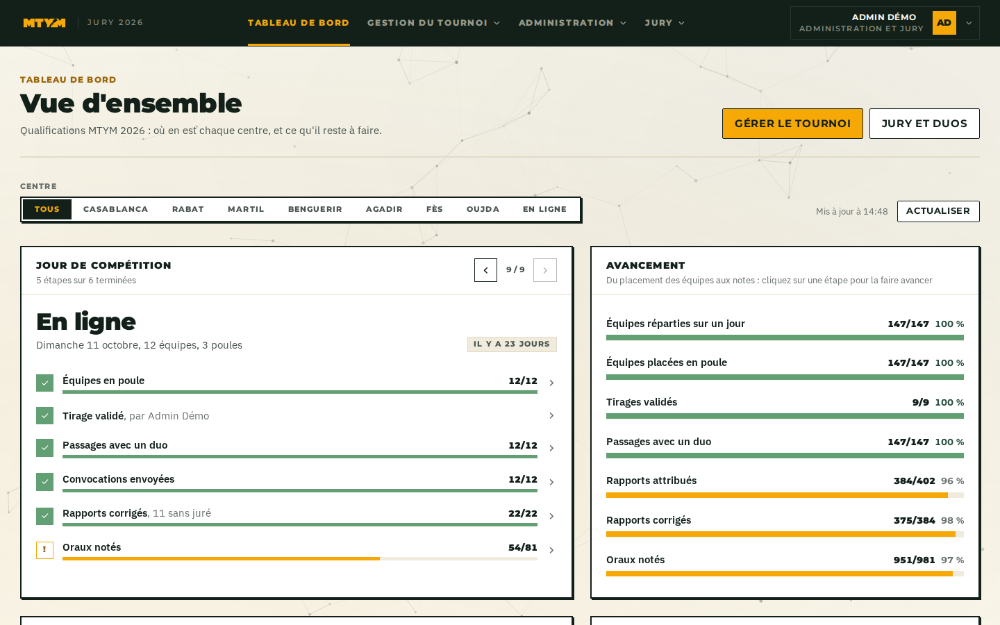
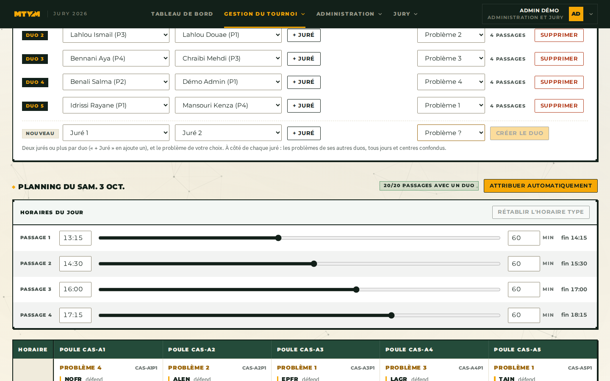
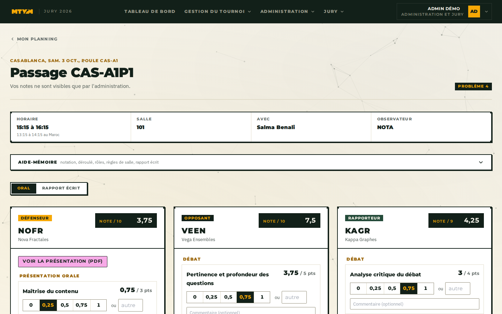
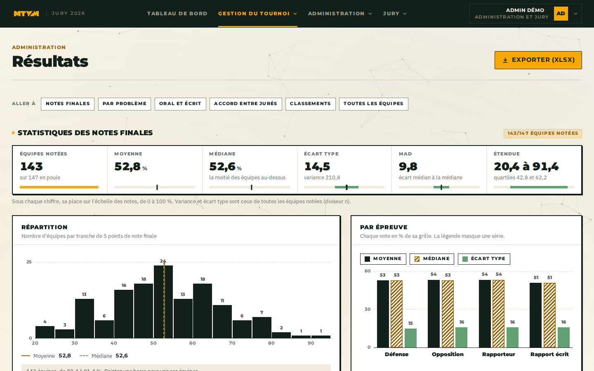
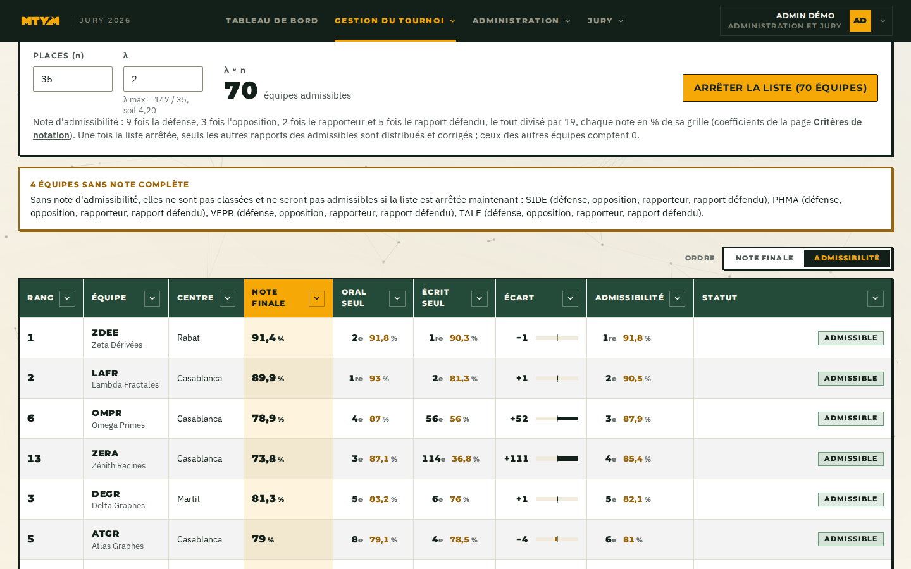

<a id="readme-top"></a>

<!-- PROJECT LOGO -->
<br />
<div align="center">
  <a href="https://mtym-jury.mathmaroc.org">
    
  </a>

<h3 align="center">MTYM 2026, jury platform</h3>

  <p align="center">
    The jury and admin platform of the Moroccan Tournament of Young Mathematicians: pools, jury duos, grading, results and the selection for the finale.
    <br />
    <a href="jury_platform/README.md"><strong>Explore the docs »</strong></a>
    <br />
    <br />
    <a href="https://mtym-jury.mathmaroc.org">Open the platform</a>
    |
    <a href="jury_platform/DEPLOY.md">Deployment guide</a>
    |
    <a href="https://github.com/Bouazz-a/mtym-2026/issues">Report a bug</a>
  </p>
</div>

<p align="center">
  
</p>


<!-- TABLE OF CONTENTS -->
<details>
  <summary>Table of Contents</summary>
  <ol>
    <li>
      <a href="#about-the-project">About The Project</a>
      <ul>
        <li><a href="#screenshots">Screenshots</a></li>
        <li><a href="#built-with">Built With</a></li>
        <li><a href="#repository-layout">Repository Layout</a></li>
      </ul>
    </li>
    <li>
      <a href="#getting-started">Getting Started</a>
      <ul>
        <li><a href="#prerequisites">Prerequisites</a></li>
        <li><a href="#installation">Installation</a></li>
      </ul>
    </li>
    <li><a href="#usage">Usage</a></li>
    <li><a href="#roadmap">Roadmap</a></li>
    <li><a href="#contributing">Contributing</a></li>
    <li><a href="#license">License</a></li>
    <li><a href="#contact">Contact</a></li>
    <li><a href="#acknowledgments">Acknowledgments</a></li>
  </ol>
</details>


<!-- ABOUT THE PROJECT -->
## About The Project

The MTYM qualifications run in eight centers (Casablanca, Rabat, Martil, Benguerir, Agadir, Fès, Oujda and online), over one or more days each. Teams register on the main site, [mtym.mathmaroc.org](https://mtym.mathmaroc.org). This repository holds the platform the organizers and the jurors use from there on, served at [mtym-jury.mathmaroc.org](https://mtym-jury.mathmaroc.org).

**For the organizers (admin accounts)**
* Import the approved teams, their members, final reports and presentations from a dump of the main site.
* Draw the pools of each center and day, or compose them by hand, then validate the day.
* Form the jury duos and give each passage its duo, by hand or automatically.
* Hand out the written reports a team doesn't defend, each to one juror.
* Send each team its convocation email, with the reports it has to read.
* Follow the grading live, and see, correct or remove any juror's note.
* Read the results: final grades, statistics per problem, oral against written, agreement between jurors, rankings.
* Fix the list of admissibles for the finale: the first λ × n teams on the admissibility note (λ at most the teams that played divided by n).
* Export everything to Excel, with a journal of every admin change.

**For the jurors**
* A planning of the passages their duo judges, on their own clock.
* A grading grid per role (defender, opponent, reporter) and per written report, with a one-tap scale, an aide-mémoire and drafts kept in the browser.
* The defended report and presentation, opened from the passage.
* A guided practice passage before the real ones.

### Screenshots

All the data below is the fictional demo database (`./dev.sh demo`).

**Dashboard.** Where each center stands: pools, duos, grading.


**Jury duos and planning.** The duos of a center day and the passages each one judges.


**Grading a passage.** A juror's grid for the defender, the opponent and the reporter.


**Results.** Statistics of the final grades, their spread and each part of the note.


**Admissibles.** The rankings ordered on the admissibility note, with the λ × n cut.


<p align="right">(<a href="#readme-top">back to top</a>)</p>


### Built With

<p align="center">
  <a href="https://react.dev/"></a>
  <a href="https://www.typescriptlang.org/"></a>
  <a href="https://vite.dev/"></a>
  <a href="https://tailwindcss.com/"></a>
  <a href="https://expressjs.com/"></a>
  <a href="https://www.prisma.io/"></a>
  <a href="https://www.postgresql.org/"></a>
  <a href="https://www.docker.com/"></a>
</p>

Also TanStack Query, Framer Motion, Zod, Nodemailer and SheetJS. In production the API runs under pm2 behind Caddy, next to the main site.

<p align="right">(<a href="#readme-top">back to top</a>)</p>


### Repository Layout

| Path | What it is |
| --- | --- |
| [`jury_platform/`](jury_platform) | **The platform in use.** `backend/` (Express, Prisma), `frontend/` (React), `scripts/` (deployment, team import, demo database). |
| [`dev.sh`](dev.sh) | Runs the platform locally in one terminal. |
| [`backend/`](backend), [`frontend/`](frontend) | The first prototype of the MTYM 2026 platform (a browser-only demo), kept for reference. Not deployed. |

<p align="right">(<a href="#readme-top">back to top</a>)</p>


<!-- GETTING STARTED -->
## Getting Started

### Prerequisites

* Node.js 22 and npm
* Docker with Compose, for the PostgreSQL database

### Installation

1. Clone the repository
   ```sh
   git clone git@github.com:Bouazz-a/mtym-2026.git
   cd mtym-2026
   ```
2. Create the two environment files from their examples, and fill in the database password and `JWT_SECRET`
   ```sh
   cp jury_platform/.env.example jury_platform/.env
   cp jury_platform/backend/.env.example jury_platform/backend/.env
   ```
3. Start everything: the database, the API on http://127.0.0.1:3001 and the interface on http://localhost:5173. The first run installs the dependencies and applies the migrations.
   ```sh
   ./dev.sh
   ```
4. In another terminal, load the default grading criteria and create your admin account
   ```sh
   cd jury_platform/backend
   npm run db:seed
   npm run create-admin -- you@example.com Prénom Nom
   ```

The step by step version, and how to import teams, are in [jury_platform/README.md](jury_platform/README.md).

<p align="right">(<a href="#readme-top">back to top</a>)</p>


<!-- USAGE EXAMPLES -->
## Usage

To see every page with data without touching your own, run the platform on the demo database: a whole fictional qualification phase, 147 made-up teams in the eight centers, graded.

```sh
./dev.sh demo          # http://localhost:5174
./dev.sh demo fresh    # the same, rebuilt from scratch
```

Sign in as `admin@demo.test`, password `demo-mtym-2026`. Every demo juror has the same password. It runs next to `./dev.sh` (API 3002), and emails are written to `jury_platform/outbox/` instead of being sent.

Checks, before a commit:

```sh
cd jury_platform/frontend && npm run lint && npx tsc -b && npm test
cd jury_platform/backend && npm run typecheck && npm test
```

Deployment on the server is `jury_platform/scripts/deploy.sh`; see [DEPLOY.md](jury_platform/DEPLOY.md).

<p align="right">(<a href="#readme-top">back to top</a>)</p>


<!-- ROADMAP -->
## Roadmap

- [x] Team import from the main site, reports and presentations
- [x] Pool draws per center and day, pools composed by hand
- [x] Jury duos, automatic assignment of passages and reports
- [x] Convocation emails
- [x] Grading of the orals and the written reports
- [x] Notes by passage and by juror, corrections by the admins
- [x] Results, statistics and rankings
- [x] Selection of the finalists
- [ ] The finale: two rounds, national


<p align="right">(<a href="#readme-top">back to top</a>)</p>


<!-- CONTRIBUTING -->
## Contributing

The platform is run by the MTYM organizing committee. To propose a change:

1. Fork the project
2. Create your feature branch (`git checkout -b feature/my-change`)
3. Commit your changes (`git commit -m 'feat(scope): what it does'`)
4. Push to the branch (`git push origin feature/my-change`)
5. Open a pull request

Never commit a dump of the main site: it contains personal data (`*.sql` and `*.dump` are ignored).

<p align="right">(<a href="#readme-top">back to top</a>)</p>


<!-- LICENSE -->
## License

No license has been chosen yet: all rights reserved by the MTYM organizing committee.

<p align="right">(<a href="#readme-top">back to top</a>)</p>


<!-- CONTACT -->
## Contact

MTYM organizing committee: mtym@mathmaroc.org

Project link: [https://github.com/Bouazz-a/mtym-2026](https://github.com/Bouazz-a/mtym-2026)

<p align="right">(<a href="#readme-top">back to top</a>)</p>


<!-- ACKNOWLEDGMENTS -->
## Acknowledgments

* [Math&Maroc](https://mathmaroc.org), who run the MTYM
* The jurors of the 2026 qualifications
* [Best-README-Template](https://github.com/othneildrew/Best-README-Template), the template of this README
* [particles.js](https://vincentgarreau.com/particles.js/), the idea behind the particle background
* [Shields.io](https://shields.io)

<p align="right">(<a href="#readme-top">back to top</a>)</p>
